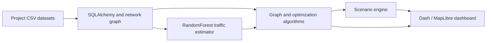

# CairoFlow

**Transportation network optimization | Algorithms · Python · Dash · MapLibre · scikit-learn**

CairoFlow is an interactive engineering project that models Greater Cairo as a weighted transportation network. It compares shortest paths, time-aware routing, infrastructure planning, resource allocation, and simulated disruptions using classical algorithms and a small traffic-prediction model.

[**Code**](src/) · [**Tests**](tests/) · [**Engineering documentation**](docs/INDEX.md) · [**Demo**](https://cairo-flow.onrender.com/) *(availability may vary)* · [**CI run**](https://github.com/ZeyadAli999/CAIRO_FLOW/actions/runs/39758074617)

> **Scope:** This is a course-originated **simulation and algorithm demonstrator**. It is not a production traffic navigation service, and its traffic observations are not live city sensor measurements.

## What the system does

| Capability | Algorithms / implementation | Evidence |
| --- | --- | --- |
| Routing | Dijkstra, A*, time-dependent shortest paths and traffic-adjusted costs | [Code](src/algorithms/shortest_path.py) · [Tests](tests/test_shortest_path.py) |
| Network design | Kruskal and Prim minimum spanning structures | [Code](src/algorithms/mst.py) · [Tests](tests/test_mst.py) |
| Resource allocation | Knapsack and dynamic-programming transit scheduling | [Code](src/algorithms/dp.py) · [Tests](tests/test_dp.py) |
| Signal management | Greedy signal allocation and emergency prioritization | [Code](src/algorithms/greedy.py) · [Tests](tests/test_greedy.py) |
| Multimodal transit | Graph composition and transfer-point analysis | [Code](src/algorithms/multimodal.py) · [Tests](tests/test_multimodal.py) |
| Scenario simulation | Rush-hour, road closure, maintenance and emergency dispatch | [Code](src/simulation/framework.py) · [Tests](tests/test_simulation.py) |
| Traffic estimates | RandomForestRegressor on project-provided edge/time records | [Code](src/ml/traffic_predictor.py) · [Tests](tests/test_ml.py) |

## Architecture



The road graph is the shared representation. Routing uses scenario-specific cost functions, optimization algorithms return structured decisions, and the UI visualizes route trade-offs and intermediate states. The traffic-prediction model is **not** the source of every routing result; classical algorithms can operate on observed/project-provided traffic values independently.

## Decisions and limitations

- **Objective-specific routing:** shortest *distance* and shortest *travel time* are separate optimization objectives; they should not be compared as if the scores were interchangeable.
- **Disconnected network behavior:** isolated facilities/graph components and inferred emergency connectors are documented rather than hidden ([data notes](docs/data_optimization_report.md)).
- **Inspectable algorithms:** implementations and regression tests are separate from UI callbacks. A*/Dijkstra exploration is visible in the Race Lab.
- **Limited ML evidence:** the RandomForest component uses 112 edge/time observations derived from project records, not continuous real-world sensor feeds. Generalization to live traffic is unverified.
- **No production guarantee:** hosted demo availability, large-scale performance, user demand forecasts, and real-city navigation accuracy have not been independently verified.

## Run locally

Requires **Python 3.12**.

```bash
python -m venv .venv
# Windows: .venv\Scripts\activate
# Linux/macOS: source .venv/bin/activate
python -m pip install -r requirements.txt
python app.py
```

Open `http://127.0.0.1:8050`. The app initializes its local data from the project CSV files.

### Automated tests

```bash
python -m pytest -q
```

[GitHub Actions](.github/workflows/ci.yml) runs the test suite on Python 3.12 for PRs and pushes to `main`. The [initial CI run passed](https://github.com/ZeyadAli999/CAIRO_FLOW/actions/runs/39758074617). The previous README's **201 passed** count is a historical run, not a promise about every future environment.

### Docker

```bash
docker build -t cairoflow .
docker run --rm -p 8050:8050 cairoflow
```

See [deployment documentation](docs/deployment.md) for further notes.

## Project map

```text
src/algorithms/    Core graph, greedy and DP algorithms
src/graph/         Transportation network builders
src/db/            Database schemas, queries and seeding
src/simulation/    Scenario and benchmark orchestration
src/ml/            Experimental traffic estimator
src/ui/            Interactive Dash components
tests/             Regression and algorithm tests
data/raw/          Project datasets
docs/              Technical docs and preserved course history
```

The original course submissions, phase-by-phase notes and reports are preserved under [docs/history](docs/history/); they are intentionally separated from the primary engineering walkthrough.

## Acknowledgment

Built as a CSE112 Design & Analysis of Algorithms project. The network scenarios and simulated data are educational and should be assessed in that context.
