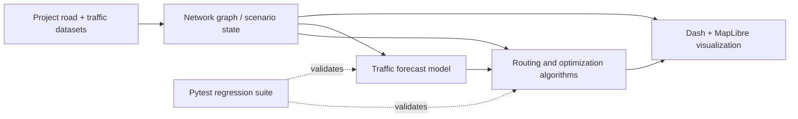

# CairoFlow — Smart City Transportation Network Optimizer for Greater Cairo

CairoFlow is an interactive CSE112 **Design & Analysis of Algorithms** project that models Greater Cairo as a weighted transportation network. It demonstrates how graph algorithms, dynamic programming, greedy optimization, simulation, machine learning, and premium map visualization can support smart-city transportation decisions.

The project is delivered as a live Dash + MapLibre web dashboard with deployable engineering support through Render and Docker.

---

## Engineering snapshot

**An algorithms-and-systems project, not a live traffic navigation service.** CairoFlow models a weighted road network and explores routing, infrastructure design, resource allocation, and congestion scenarios through a browser dashboard.

| Engineering area | Implemented techniques | Where to inspect |
| --- | --- | --- |
| **Graph search** | Dijkstra, A*, time-dependent routing, graph exploration comparisons | [Algorithms](src/algorithms/) · [Routing tests](tests/test_shortest_path.py) |
| **Network / resource optimization** | Kruskal, Prim, 0/1 Knapsack, dynamic programming, and greedy scheduling | [Algorithm modules](src/algorithms/) · [Optimization tests](tests/test_dp.py) |
| **Scenario modeling** | Peak congestion, incidents, emergency dispatch, maintenance and transit allocation | [Simulation](src/simulation/) · [Scenario tests](tests/test_simulation.py) |
| **Machine learning** | RandomForest congestion estimator trained on project-provided edge/time records | [Predictor](src/ml/traffic_predictor.py) · [ML tests](tests/test_ml.py) |
| **Software delivery** | Dash + MapLibre UI, Docker/Gunicorn, Render configuration, and pytest | [Application](app.py) · [Test suite](tests/) · [Dockerfile](Dockerfile) |

### How the system fits together



### Decisions and limitations

- **Algorithm outputs are distinguished by objective.** Shortest-distance routing and traffic-aware travel-time routing solve different problems, so their results must not be compared as interchangeable costs.
- **Comparisons are inspectable.** The project includes A* vs. Dijkstra exploration comparisons, scenario configurations, and focused correctness tests.
- **Model scope is intentionally small.** The RandomForest predictor uses 112 project-provided edge/time observations (28 road edges across four time-of-day buckets), not a continuously updated citywide sensor feed.
- **Simulation is not a production claim.** Traffic, incident and resource scenarios are illustrative project data. The README records a historical result of **201 passing tests**; prospective reviewers should run the suite in their environment before treating it as current.
- **Deployment evidence:** [Live demo (availability may vary)](https://cairo-flow.onrender.com/) · [Demo video](https://drive.google.com/file/d/1KsuF2ga9XD7zP1jJdw31tu_ZgH-R6fJG/view?usp=sharing) · [Run tests](#run-tests).

---

## Submission Links

| Item | Link |
|---|---|
| GitHub Repository | https://github.com/ZeyadAli999/CAIRO_FLOW |
| Live Demo | https://cairo-flow.onrender.com |
| Health Check | https://cairo-flow.onrender.com/healthz |
| Demo Video | https://drive.google.com/file/d/1KsuF2ga9XD7zP1jJdw31tu_ZgH-R6fJG/view?usp=sharing |
| LinkedIn Post | https://www.linkedin.com/posts/zeyad-said-033472357_smartcities-transportationtechnology-algorithms-ugcPost-7460179410831360001-YodU?utm_source=share&utm_medium=member_desktop&rcm=ACoAAFjhJKcBSB5e-KBvzjrJ7xr3OZZrtpfhndo |

---

## Final Verification Status

| Check | Result |
|---|---|
| Latest Git Commit | `ace2d05` — `Finalize CairoFlow demo polish and scenario features` |
| Full Test Suite | `201 passed` |
| App Import | `app import ok` |
| Render Health Check | `tests_passing: true`, `callbacks_registered: 42` |
| Docker Build | `docker build -t cairoflow .` succeeded |
| Docker Runtime | `docker run --rm -p 8050:8050 cairoflow` started Gunicorn successfully |
| Docker Health Check | `/healthz` returned HTTP `200 OK` |

---

## What CairoFlow Demonstrates

CairoFlow is organized around the main algorithmic requirements of a smart transportation system:

| Area | Algorithms / Models | Where It Appears |
|---|---|---|
| Infrastructure Network Design | Kruskal MST, Prim MST, Population-Weighted MST | Network Mode |
| Route Planning | Dijkstra, A* Search, Time-Dependent Dijkstra, BPR traffic-time model | Route Mode |
| Algorithm Comparison | Dijkstra vs A* Race, explored nodes, explored edges, replay | Race Lab |
| Traffic Scenarios | Normal Traffic, Peak Congestion, Incident on Shortest Route | Route Mode + Race Lab |
| Emergency Dispatch | A* Emergency Routing, traffic-aware response time | Emergency Mode |
| Road Maintenance | 0/1 Knapsack Dynamic Programming | Maintain Mode |
| Transit Optimization | Bus Fleet Allocation DP, Metro Train-Hour Allocation DP | Transit Mode |
| Multimodal Planning | Multimodal Shortest Path, Transfer Hub Ranking | Transit Mode |
| Greedy Optimization | Greedy Signal Timing, Greedy Emergency Preemption | Signals Mode |
| Machine Learning | scikit-learn RandomForestRegressor traffic forecast | Route Mode ML Forecast |
| Simulation | Peak rush, road closure, emergency dispatch, maintenance, transit, signals | Simulation Framework |
| Visualization | Premium MapLibre Cairo map, overlays, 24h time presets | Main Dashboard |

---

## Bonus Coverage

This section maps CairoFlow directly to the CSE112 bonus checklist.

| Bonus Requirement | CairoFlow Evidence |
|---|---|
| Early Submission | Submission time can be proven through LMS/GitHub timestamps. |
| AI Tools & Technologies | See `docs/ai_tools_and_technologies.md`. |
| Enhanced Visualization & UI | Premium landing hero, Algorithm Mission Briefing, MapLibre Cairo dashboard, Race Lab, Signals map overlay, algorithm badges, smooth transitions. |
| Deployment & Engineering | Render deployment, `/healthz`, Dockerfile, Docker runtime proof, automated tests. |
| GitHub Repo + Good README + Demo + LinkedIn Post | GitHub repository, final README, demo video, and LinkedIn post are linked above. |
| ML-Based Traffic Prediction | Route Mode ML Forecast uses scikit-learn RandomForestRegressor trained on temporal traffic data. |
| Side-by-Side Algorithm Visualizer | Race Lab compares Dijkstra vs A* with map panels, explored nodes, explored edges, replay, and winners. |
| Live Web App | https://cairo-flow.onrender.com |
| Docker Containerization | `Dockerfile`, `.dockerignore`, successful `docker build`, successful `docker run`, and health check. |

---

## Best Demo Flow for Professors

Use this exact flow during the live demo:

1. **Landing Hero**
   - Open the live app.
   - Show the premium CairoFlow landing hero.
   - Click **Explore Algorithms** to show the Algorithm Mission Briefing.

2. **Start Simulation**
   - Click **Start Simulation**.
   - Show the main dashboard and the Cairo map.

3. **Route Mode — Shortest Is Not Always Fastest**
   - Open **Route Mode**.
   - Use:
     - From: `1`
     - To: `11`
     - Scenario: `Peak Congestion`
     - Time: `Morning`
   - Show:
     - Shortest-distance route: `1 → 3 → F2 → 11`, `14.60 km`, `48.00 min`
     - Traffic-aware route: `1 → 8 → 10 → 11`, `18.20 km`, `20.02 min`
   - Explain:
     - Dijkstra wins shortest distance.
     - Traffic-aware routing wins travel time.
     - Distance is compared with distance, and minutes are compared with minutes.

4. **Race Lab — Dijkstra vs A***
   - Open **Race Lab**.
   - Use `1 → 11`, `Peak Congestion`.
   - Show side-by-side Dijkstra and A* panels.
   - Explain:
     - Dijkstra expands by lowest known cost.
     - A* uses a heuristic to explore fewer nodes.
     - A* can reach the same or better objective with less search effort.

5. **Signals Mode — Greedy Algorithm**
   - Open **Signals**.
   - Select `Morning` and an intersection such as `Maadi (1)` or `Dokki (10)`.
   - Click **Run Greedy Signal Audit**.
   - Show:
     - Greedy Signal Timing
     - Green-time allocations
     - Gini fairness score
     - Selected intersection and connected approaches on the map
     - Emergency Preemption using Greedy Priority Scheduling

6. **Network Mode — MST**
   - Open **Network Mode**.
   - Show Kruskal MST and Prim MST.
   - Explain the infrastructure design objective.

7. **Emergency Mode**
   - Show emergency A* dispatch.
   - Recommended demo: `11 → Medical`, selected facility `F9`, traffic-aware response time around `8.32 min`.

8. **Transit Mode**
   - Show Bus Fleet Allocation DP, Metro Train-Hour Allocation DP, and Multimodal Shortest Path.

9. **Maintain Mode**
   - Show Road Maintenance Planning with 0/1 Knapsack DP.
   - Recommended budget example: `500M EGP`.

10. **ML Forecast**
    - Open Route Mode ML Forecast.
    - Show that predictions change by time of day.

---

## Key Demo Numbers

| Feature | Best Case | Result |
|---|---|---|
| Route Scenario | `1 → 11`, Peak Congestion | Shortest: `14.60 km / 48.00 min`; Traffic-aware: `18.20 km / 20.02 min` |
| Race Lab | `1 → 11`, Peak Congestion | Dijkstra explored `10`; A* explored `4` |
| Search Efficiency | `3 → F1`, Incident | A* explores `8` fewer nodes |
| Emergency | `11 → Medical` | Selected `F9`, about `7.57 km`, `8.32 min` |
| Maintenance DP | `500M EGP` budget | 5 selected repairs, `234.5M` cost, benefit around `279.97` |
| Transit | Bus DP / Metro DP | Bus and metro allocations optimized with DP |
| ML Forecast | `1 → F1` | Predicted congestion changes by time of day |
| Docker | `docker build -t cairoflow .` | Build completed successfully |
| Health Check | `/healthz` | HTTP `200 OK`, `tests_passing: true` |

---

## Quickstart

### Windows PowerShell

```powershell
python -m venv .venv
.\.venv\Scripts\activate
pip install -r requirements.txt
python app.py
```

Then open:

```text
http://127.0.0.1:8050
```

On first run, CairoFlow seeds `data/cairo.db` from the CSV files in `data/raw/`.

---

## Docker

Build the image:

```bash
docker build -t cairoflow .
```

Run the container:

```bash
docker run --rm -p 8050:8050 cairoflow
```

Open:

```text
http://127.0.0.1:8050
```

Health check:

```bash
curl http://127.0.0.1:8050/healthz
```

Expected result:

```text
HTTP 200 OK
tests_passing: true
```

The container starts the app with Gunicorn:

```bash
gunicorn app:server --bind 0.0.0.0:${PORT:-8050}
```

---

## Render Deployment

The project includes `render.yaml` for Render deployment.

Recommended Render settings:

| Setting | Value |
|---|---|
| Build Command | `pip install -r requirements.txt` |
| Start Command | `gunicorn app:server --bind 0.0.0.0:$PORT` |
| Health Check Path | `/healthz` |

Live demo:

```text
https://cairo-flow.onrender.com
```

Health check:

```text
https://cairo-flow.onrender.com/healthz
```

---

## Run Tests

Full test suite:

```powershell
.\.venv\Scripts\python.exe -m pytest -q
```

Verified result:

```text
201 passed
```

App import check:

```powershell
.\.venv\Scripts\python.exe -c "import app; print('app import ok')"
```

JavaScript syntax checks:

```powershell
node --check assets\clientside.js
node --check assets\maplibre_view.js
node --check assets\race.js
```

---

## Health Endpoint

Local:

```bash
curl http://127.0.0.1:8050/healthz
```

Live:

```bash
curl https://cairo-flow.onrender.com/healthz
```

The endpoint reports:

- `tests_passing`
- `callbacks_registered`
- `assets_present`
- `lucide_icons_in_layout`
- `phase`
- `version`

---

## Simulation CLI

Run scenario simulations from the command line:

```bash
# Peak traffic
python -m src.simulation.framework --scenario peak_rush --from 1 --to F1

# Road closure
python -m src.simulation.framework --scenario road_closure --from 1 --to 2 --closed "1-3"

# Emergency dispatch
python -m src.simulation.framework --scenario emergency_dispatch --from 11 --facility-type "Transit Hub"

# Maintenance DP
python -m src.simulation.framework --scenario maintenance_budget

# Transit DP
python -m src.simulation.framework --scenario transit_optimization --total-buses 200

# Greedy signal audit
python -m src.simulation.framework --scenario signal_audit --tod morning_peak

# Multimodal demand
python -m src.simulation.framework --scenario multimodal_demand
```

Add `--json` to emit machine-readable output.

---

## Premium MapLibre Setup

CairoFlow uses MapLibre GL JS for the main Cairo map.

The browser needs internet access for vector tiles/CDN map resources.

Style priority:

1. `MAP_STYLE_URL` — any MapLibre-compatible style JSON URL.
2. `MAPTILER_KEY` — MapTiler `streets-v2`.
3. OpenFreeMap Bright — keyless fallback for local demos.

If vector resources cannot load, CairoFlow shows a non-blocking warning instead of pretending a broken map is premium.

---

## Time-of-Day Behavior

Time of Day affects real outputs, not only the map style.

| Module | Effect |
|---|---|
| Route Mode | Traffic-time and sometimes traffic-aware path change by time. |
| Race Lab | Traffic-time metrics change by time; explored nodes may stay stable for the same search objective. |
| Signals Mode | Demand, green allocation, Gini, and status counts change by time. |
| ML Forecast | Predicted congestion changes by time. |
| Map | Visual preset changes between Morning, Afternoon, Evening, and Night. |

---

## Data and Safety Notes

The original CSV files in `data/raw/` remain the source of truth.

CairoFlow uses safe, clearly separated layers:

- Scenario changes are applied in memory only.
- Raw data is not mutated by traffic scenarios.
- Emergency Medical connectors are inferred and marked for emergency routing.
- ML forecasting is educational and based on the provided temporal traffic dataset.
- All major algorithms are implemented in source code and exposed through UI badges, explanations, or traces.

---

## Project Structure

```text
cairoflow/
├── app.py                         Dash entry point, callbacks, /healthz
├── requirements.txt
├── Dockerfile
├── render.yaml
├── data/
│   ├── raw/                       Original CSV datasets
│   └── cairo.db                   SQLite database created on first run
├── src/
│   ├── algorithms/
│   │   ├── mst.py                 Kruskal, Prim, population-weighted MST
│   │   ├── shortest_path.py       Dijkstra, A*, BPR, alternatives
│   │   ├── race.py                Dijkstra vs A* replay data
│   │   ├── dp.py                  Knapsack, bus/metro DP, memoization
│   │   ├── greedy.py              Signal timing, preemption, audit
│   │   └── multimodal.py          Road + metro + bus graph
│   ├── graph/
│   │   └── builder.py             NetworkX graph builders
│   ├── ml/
│   │   └── traffic_predictor.py   scikit-learn forecast model
│   ├── scenarios/
│   │   └── traffic_scenarios.py   In-memory scenario calibration
│   ├── simulation/
│   │   └── framework.py           Scenario simulation API and CLI
│   └── ui/
│       ├── network_mode.py
│       ├── route_mode.py
│       ├── race_view.py
│       ├── emergency_mode.py
│       ├── maintain_mode.py
│       ├── transit_mode.py
│       ├── signals_mode.py
│       └── layout.py
├── assets/
│   ├── hero.html                  Landing hero + Algorithm Mission Briefing
│   ├── style.css
│   ├── clientside.js              Dash client bridge + hero/map bridge
│   ├── maplibre_view.html
│   ├── maplibre_view.js           MapLibre layers and overlays
│   ├── race.js                    Race animation support
│   └── NEW_LOGO.png
└── tests/                         201 passing tests
```

---

## License

Coursework submission for CSE112.

Copyright held by the authors.
